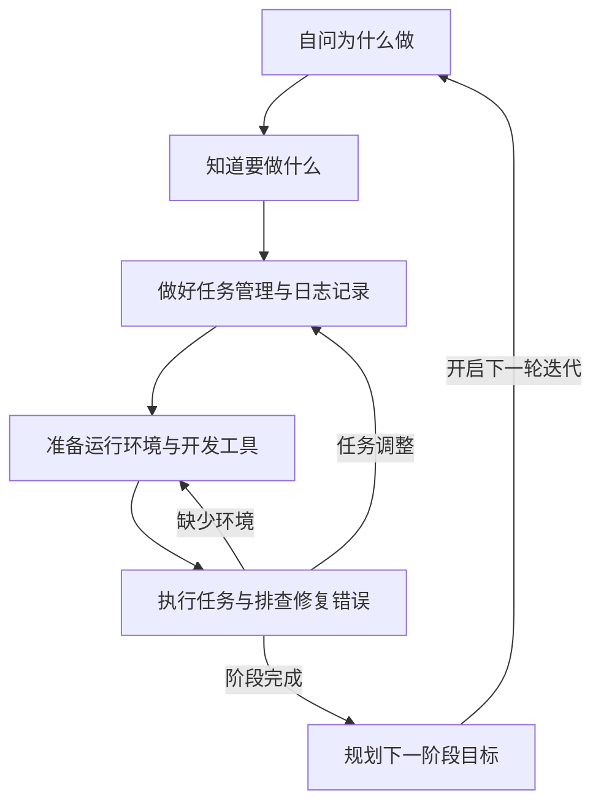

工程上的任何一件事情，都具备三步的流程结构，从为什么到做什么，再到怎么做。

要确保事情能做成，就要建立起一些基本认知，训练工程素养。

第一项认识，就是掌握下面图中的这个行动回路。知道意图、目标、成功条件的差别，也要区分运行环境与开发工具，还要积极拥抱任务管理与日志记录，才能够快速地排查修复遇到的错误。

## 自问为什么做

自问为什么做，就是在明确意图，也就是做这件事情的价值、意义。

价值就是能带来长期收益的心理预期。举例来说，我预期投入到VS Code的Markdown Editor的问题修复和新功能开发中会有长期收益。

长期收益是两个。第一，就是工具本身的使用价值。VS Code类的编辑器我会长期使用，并且我需要所见即所得的编辑反馈，而不是编辑完后再去浏览。别的扩展没有这项功能；Markdown Editor整体效果不错，我从头开发又没必要；Obsidian对非markdown文件支持不友好，对AI agent接入支持不友好。

第二，就是开源项目贡献。这个扩展下载人数23万、评分4.5，GitHub收藏611个、问题110个、贡献者12个，处于上升阶段，是一个扩大影响力、展现开发能力、回馈开源社区的不错项目。

价值选择，并不只意味着收益，还意味着放弃了其他机会。这中间的利弊权衡，只能自己去体会，处境、能力、机会、发展，理性的算计通常都是无效的。

意义是价值的主观面，有情绪与情感的因素在，需要借助理性、短期行动反馈去调节感受。

## 知道要做什么

知道要做什么，就是在定义目标，制定成功的标准。

目标的核心是一种状态，是一个对象的一种程度。描述式的说法不可操作、不可验证成功，需要转换成任务的形式，才可以操作，才能验证成功与失败。

任务的形式要素是个五元组(谁, 条件, 资源, 动作, 结果)，基本句式是“**谁**，在**什么条件**下，对**什么资源**，做了**什么动作**，产生了**什么结果**”。目标描述中所要的那个状态，就是结果对象的一个取值。

这样说太抽象了，要在场景中找目标和任务。继续拿上面的例子，我在使用Markdown Editor编辑的时候，发现每次一保存，光标就跳回到开头的位置，这中断干扰了我的编辑任务，我需要一个修复任务，让编辑任务的保存动作结果是光标停在当前位置。

至此，我的目标清晰了，编辑任务中，保存执行后，光标仍旧停在当前位置。成功标准也明确了，如果这种条件下光标仍旧停在当前位置，那么任务就执行成功了，否则就失败了。

在目标定义中，切记不要将手段当成目的，比如把成功修复了一个程序缺陷当成目标。缺陷的发现任务、缺陷的修复任务都是由目标派生出来的，而且目标达成的手段不止一个。定义目标，要围绕一个场景中原本任务的一个问题进行描述。

## 做好任务管理与日志记录

从这里，开始进入怎么做的部分。任务管理、日志记录是确保任务高效、高质量完成的关键。

这里面最重要的，就是认识到任务的嵌套与自相似。认识到这两点，才能避免陷入到流程的子环节中。要预防傲慢，保持谦逊，好记忆不如烂笔头。

任务在一个人执行的时候是线性的、流式的，可任务本身的结构绝不是线性的，而是一个环可终止的图，节点是任务，边是资源依赖形成的条件，任务间存在嵌套关系。

行动回路具有自相似性。每一个为什么、做什么、怎么做，也都依旧自相似地可以问，为什么、做什么、怎么做。

利用任务的自相似性与图结构，可以做好任务的拆解。把拆解后的任务限定在两三个，让一到两天能做完一个，这样内心会有一些成就感，跟自我愉悦感。

继续上面的例子，要修复那个保存后光标符合预期的任务，我需要做至少三个任务：

1. 在本地准备好开发环境并复现问题：运行代码库编译打包出的扩展程序，确定问题依旧存在；
2. 找到缺陷代码并设计修复方案：理解扩展的设计，熟悉代码结构，找到缺陷代码片段和逻辑问题，设计修复方案；
3. 实施修复方案并发布变更：实现修复方案，添加测试，运行完整测试回归，避免改坏其他逻辑，本地发布并测试后，提交Pull Request。

在这三个任务之外，其实还有很多其他的任务，比如完整的发布要确保Pull Request能被合并，我需要联系作者，回复他的评论，再比如，我没有做过VS Code的扩展开发，发布流程也不清楚，我可能希望写一篇博客文章，也就是现在在做的事情。

以上两个比如是任务的广度方面，本节主要在说深度方面，每个任务其实都有三个天然的子任务要做：

1. 主任务：完成当前任务的主流程；
2. 任务管理任务：主流程的环节其实还可以接续拆，这个管理，是在子任务模糊时，进行规划和记录；
3. 日志记录任务：将探索性的关键结果和步骤原样记录，并归纳整理，为日后重复任务做参考，提高效率。

## 准备运行环境与开发工具

## 执行任务与排查修复错误

## 规划下一阶段目标
